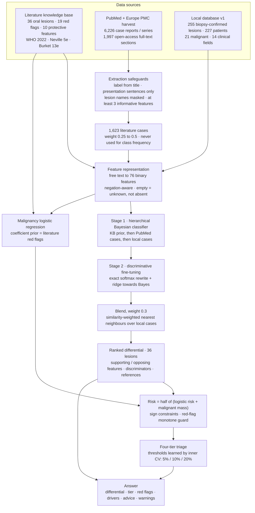
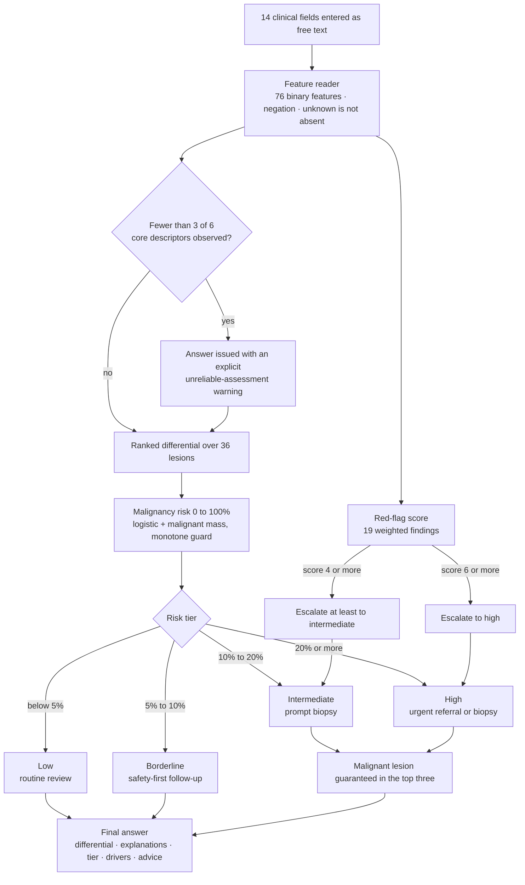

# Oranosis v1

You describe a peripheral exophytic oral lesion in 14 clinical fields. The tool returns a ranked differential diagnosis over 36 lesions and a four-tier malignancy risk, with the features that argued for and against each diagnosis. The engine is JavaScript in the browser tab: no server, no API key, no network request after the first load, and nothing you type leaves the device.

Live site: [oranosis.ir](https://oranosis.ir)

## Credits

DDS, DMD Dr. Mohammad Reza Zeinali
ORCID [0009-0000-9635-4337](https://orcid.org/0009-0000-9635-4337)
School of Dentistry, Shahid Beheshti University of Medical Sciences, Tehran, Iran.

He assembled the clinical knowledge base, built and trained the model, ran the validation, wrote the software, and wrote this documentation.

## Abstract

Objective. To test whether a transparent probabilistic model, built from published clinical knowledge and labelled case material, can rank the histopathologic diagnosis of a peripheral exophytic oral lesion and estimate its malignancy risk from routine clinical description alone, offline, and at the level of the clinicians who saw the same patients.

Methods. A literature knowledge base of 36 peripheral oral lesions and 19 malignancy red flags was combined with 1,623 presentations extracted from 6,226 PubMed case reports and with 255 biopsy-confirmed lesions from 227 patients, 21 of them malignant. A reader maps the 14 free-text clinical fields onto 76 binary features, handling negation and treating an empty field as unknown rather than absent. A hierarchical Bayesian classifier is fine-tuned as a softmax regression and blended with a nearest-neighbour vote over the local cases. Malignancy risk averages a logistic regression, whose starting coefficients are the literature red flags, with the malignant share of the differential, under a constraint that adding a red flag can never lower the risk. Settings and the three risk thresholds were chosen by nested cross-validation, 10 folds repeated 3 times. Histopathology was the reference standard. The same 255 lesions had already been diagnosed by Grok 4.5 and by oral medicine clinicians, which gives two benchmarks.

Results. Oranosis put the histopathologic diagnosis first in 61.8% of the 255 lesions and in the top three in 83.8% (Cohen's kappa 0.532); the malignancy AUC was 0.953 with a Brier score of 0.035. Top-three agreement was higher than Grok 4.5 at 78.4% (paired McNemar P = .04) and close to the clinicians' 79.2% of any-listed agreement, while the clinicians stayed ahead on the single correct diagnosis at 67.5%. At the safety-first tier the engine found 20 of 21 cancers, a sensitivity of 95.2% at 66.1% specificity. The intermediate tier gave 87.3% and 87.2%, the urgent tier 76.2% and 96.4%. The engine always returns an answer.

Conclusions. Clinical knowledge, encoded as a prior and updated with case data, reached clinician-level malignancy sensitivity on one biopsy-confirmed series and stayed explainable feature by feature. Multicentre and prospective validation is required before clinical use.

Keywords: mouth neoplasms, oral pathology, clinical decision support, machine learning, Bayesian inference, squamous cell carcinoma.

Every figure above comes from the project's nested cross-validation and is recomputed from the source data by the project's audit script before each release.

## 1. What Oranosis v1 is

Peripheral exophytic lesions are among the most frequent specimens an oral biopsy service receives. Irritation fibroma, pyogenic granuloma, peripheral giant cell granuloma, epulis fissuratum, papilloma and mucocele account for most of them. A minority are malignant, and squamous cell carcinoma, verrucous carcinoma, lymphoma and metastases can all arrive as an exophytic mass that looks reactive at first glance. Reported clinicopathological concordance for these lesions ranges from about 50% to 80%, and a delayed diagnosis of oral cancer is associated with a more advanced stage at presentation.

Large language models have been proposed as diagnostic assistants for exactly this decision. In the 255-lesion series behind this tool, Grok 4.5 named the correct diagnosis first in 55.7% of cases. The same series showed what happens when a clinical question is routed through a chat model: answers move with model version and prompt wording, references can be invented, predictions cannot be calibrated to the local population, and a small number of cases come back as "insufficient data", one of which was a squamous cell carcinoma. The patient description also has to leave the clinic before anyone gets an answer, which rules the approach out for routine use in most settings.

Oranosis v1 is the same clinical task solved as software rather than as a conversation:

1. Published knowledge becomes the prior. For each of 36 lesions the engine holds a probability, a feature profile, the findings that argue for and against it, a clinical summary, bedside discriminators and references. Nineteen findings carry red-flag weights.
2. Labelled presentations update that prior. The engine reads machine-extracted PubMed case reports and a local biopsy-confirmed series. It never generates free text as an answer.
3. The answer is a ranked differential with the evidence attached. Each entry lists its supporting and opposing features and the literature behind it, so a reader can disagree with the reasoning and see where.
4. Malignancy risk is a separate, explicit output: four tiers, a red-flag score, a monotone guarantee, and a rule that at the intermediate tier or above a malignant lesion is always present in the top three.
5. The whole engine runs offline. One HTML file in the browser, or a Python application on a local machine, with no patient description leaving the device.

It is a research and teaching tool. It does not replace clinical judgement or biopsy.

## 2. Methodology

### Figure 1. Development pipeline

### 2.1 Design and reference standard

The study is retrospective model development with internal validation, reported along the lines of TRIPOD+AI and STARD 2015. The Research Ethics Committee of the School of Dentistry, Shahid Beheshti University of Medical Sciences approved the protocol (IR.SBMU.DRC.REC.1404.076). Only archived closed records were used, de-identified before analysis, with no patient contact and no intervention. The reference standard is the final histopathologic diagnosis, standardised to the lesion categories of the knowledge base. Malignant means squamous cell carcinoma, lymphoma or malignant round-cell tumour, or another malignant neoplasm.

### 2.2 Data sources

| Source | Content | Role in the model |
|---|---|---|
| Literature knowledge base | 36 peripheral oral lesions with prior, feature profile, summary, discriminators and references; 19 red flags with point weights; 10 protective features | Prior, explanation text, red-flag scoring |
| PubMed case database | 1,623 single-patient presentations extracted from 6,226 case reports and series (37 lesion-specific searches) and 1,997 open-access full-text case sections | Likelihood refinement |
| Local database v1 | 255 biopsy-confirmed lesions from 227 patients, 21 malignant, described by the 14 clinical fields before biopsy | Discriminative fine-tuning, nearest-neighbour reference set, validation |

Extraction is deliberately strict, because an automatic pipeline will otherwise teach the model the wrong lesson. The label comes from the article title, the most specific lesion name wins, and a title of the form "X mimicking Y" is labelled X. Ambiguous, non-oral, animal, odontogenic or intraosseous and OPMD-only titles are dropped. From each article the pipeline keeps only the sentences that describe the patient's own presentation, so background definitions, histopathology, immunohistochemistry, treatment, follow-up and discussion never reach the features. All lesion names are masked before features are read, which stops words such as lobular, verrucous, granular or ossifying from leaking the answer. Only reports with at least three informative features are kept, and automatic cases carry a weight of 0.25 to 0.5 and never contribute to class frequencies, since case reports over-represent unusual presentations.

### 2.3 From text to features

The clinical record is free text, so the engine starts with a reader rather than a form. It maps prose onto 76 binary standardised features across nine groups: site, colour, surface, base, consistency, size, age, sex, habits, duration, course, ulceration, bleeding, pain, paresthesia, lymph nodes, tooth mobility, bone change and diascopy. Negation is handled on both sides of a finding ("no pain", "painless"), with the scope ending at a contrastive conjunction, and the reader knows the common aliases and units (age in months, size in mm). An empty field is treated as unknown and never as absent, so a missing descriptor cannot be used as reassuring evidence. When fewer than three of the six core descriptors are observed, the answer carries an explicit warning that the assessment is unreliable.

### 2.4 Differential diagnosis

Stage one is a hierarchical Bayesian classifier. Each lesion's literature profile is the prior, PubMed cases then local cases update it through smoothed feature likelihoods, and class frequencies come only from the knowledge base and the local series.

Stage two is discriminative fine-tuning. The Bayesian model is rewritten exactly as a softmax regression and fitted with a ridge penalty that pulls it back towards the Bayesian solution, then blended at weight 0.3 with a similarity-weighted nearest-neighbour vote over the local cases. The neighbour component catches feature combinations that no literature description expresses, such as gingiva plus purple plus sessile pointing to peripheral giant cell granuloma.

### 2.5 Malignancy risk and tiers

Risk averages two quantities: a Bayesian logistic regression whose starting coefficients are the literature red flags (ulceration, induration or fixation, hard nodes, paresthesia, red-white colour, high-risk sites, tobacco and alcohol, age, size, rapid growth, tooth mobility, bone change), and the total malignant probability of the differential.

Two constraints are always on. Sign constraints stop a literature red flag from ever acting as a reassuring feature, and the monotone guard stops the estimated risk from falling when a red flag is added, which was checked on 4,560 simulated additions.

The thresholds are learned rather than fixed by hand:

| Tier | How the threshold was chosen | Current value |
|---|---|---|
| Borderline, safety-first | Highest threshold that still keeps sensitivity at or above 95% | 5% or more |
| Intermediate, prompt biopsy | Expected-cost optimum, a missed cancer weighted 15 times an unnecessary biopsy | 10% or more |
| High, urgent referral | Threshold that reaches specificity at or above 97% | 20% or more |

A red-flag score of 4 or more raises the tier to at least intermediate, and 6 or more makes it high. At intermediate or high, a malignant diagnosis is always placed in the top three. The engine never declines to answer.

### Figure 2. Path of one case through the engine

### 2.6 Validation

Every figure reported here comes from nested cross-validation with 10 folds repeated 3 times on the 255 lesions. Each setting, blend weight and risk threshold was chosen inside the training folds only, so no test case influenced any choice. Agreement is Cohen's kappa, differences against Grok 4.5 are tested with the exact McNemar test on paired cases, proportion intervals are Wilson intervals and AUC intervals follow Hanley and McNeil.

| Model | Top-1 | Top-2 | Top-3 | Kappa |
|---|---|---|---|---|
| Oranosis v1, nested cross-validation | 61.8% | 77.4% | 83.8% | 0.532 |
| Grok 4.5, same 255 lesions | 55.7% | not reported | 78.4% | 0.466 |
| Clinicians in oral medicine | 67.5% | not reported | 79.2%, any listed | 0.615 |

On the 21 malignant lesions the AUC was 0.953 (0.950 to 0.954) and the Brier score 0.035. Sensitivity and specificity were 95.2% and 66.1% at the borderline tier, 87.3% and 87.2% at the intermediate tier, and 76.2% and 96.4% at the high tier. Top-three agreement with histopathology was significantly higher than Grok 4.5 (P = .04); the top-1 difference was not significant. A scenario that never used a local label, with the knowledge base and PubMed cases only, still reached an AUC of 0.961, and local fine-tuning is what lifts differential accuracy to clinical level.

### 2.7 Reproduction and quality control

The project checks its own numbers, and none is copied into a document by hand:

- The paper audit recomputes every checkable figure in the manuscript from the datasets, the code, the deployed model and the per-case predictions, and confirms that the live code path reproduces the validation path on all 255 cases. It must report zero failures.
- Unit and regression tests cover the reader, the knowledge base, the models, the pipeline, the engine, literature extraction, the web server and the browser edition.
- A self-test runs textbook cases, including the batch path.
- A stress test fuzzes 4,000 malformed records and checks invariance, clinical monotonicity, 40 reader phrasings, HTTP abuse and load.
- The browser engine is a line-by-line port of the Python engine, and an equivalence test compares them on 45,900 inputs: local cases, vignettes, reader phrasings, red-flag additions, seeded fuzz records, random feature vectors, batch files and summation or rounding edge cases. Features, differential, tier, safety insertion, red flags, warnings and advice match with zero mismatches, and the browser re-checks 24 built-in probes at every start.
- Seeds are fixed, so retraining reproduces the deployed model and the validation report bit for bit.

### 2.8 What the public build contains

The published site ships an aggregate model only. It holds no patient-level vectors, no narrative text and no identifiers, the build refuses to produce output that would, and an automated scan checks every published file against the text of the research database. The research datasets and the research model never enter this repository.

## 3. Running it

Open [oranosis.ir](https://oranosis.ir), or `index.html` from this repository, in any modern browser. Fill in the 14 fields or load one of the demonstration cases, then press Analyse. The site installs as a PWA and keeps working with the network switched off; the footer shows `offline file · self-test OK` when the internal checks pass. Four tabs cover the workflow: Assess for the differential and the risk panel, Library for the 36 lesions, Evidence for the reference library, and About for methods, limitations and the disclaimer. This edition has no batch tab, because file handling belongs to the Python package.

| File | Purpose |
|---|---|
| `index.html`, `app.js`, `app.css` | interface |
| `oranosis.js` | feature reader, models, pipeline, safety layer, explanations |
| `model.json` | public aggregate model: coefficients and thresholds |
| `knowledge.json` | lesion library, red flags, references, reader vocabulary |
| `selftest.json` | 24 probes with the answers computed by the Python reference |
| `performance.json` | validation results shown in the interface |
| `manifest.webmanifest`, `sw.js`, icons | installable offline PWA |
| `LICENSE` | MIT |

## 4. Limitations

- The local series comes from one university department, so the sensitivity intervals stay wide even with 21 malignant lesions (95.2%, 95% CI 77 to 99). External, prospective and multicentre validation is required before any clinical claim.
- The model reads text only. It uses no photographs, radiographs or histopathology images.
- Some pairs cannot be separated from clinical description alone. Giant cell fibroma and irritation fibroma are the clearest case, with giant cell fibroma at about 22% top-1. Histopathology remains the reference standard.
- Rare lesions rest mainly on literature priors, because the local series contains few of them.
- Automatically extracted literature cases are noisier than expert abstraction, which is why they are down-weighted and excluded from class frequencies.
- Predictions in the highest-risk band may under-estimate observed risk, and they never substitute for urgent biopsy.
- Oranosis v1 is a research and educational tool, not a medical device.

## 5. Citation and licence

If you use Oranosis v1 in academic work, cite this repository together with the accompanying study on the agreement of a large language model with histopathologic diagnosis of peripheral exophytic oral lesions.

The code is released under the MIT licence (see `LICENSE`). The clinical knowledge base, the model and this documentation are provided for research and teaching, with no clinical warranty.
